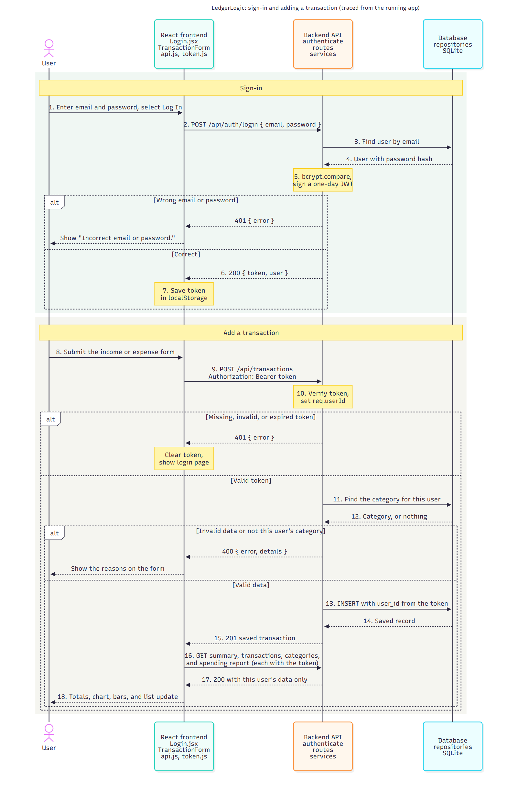
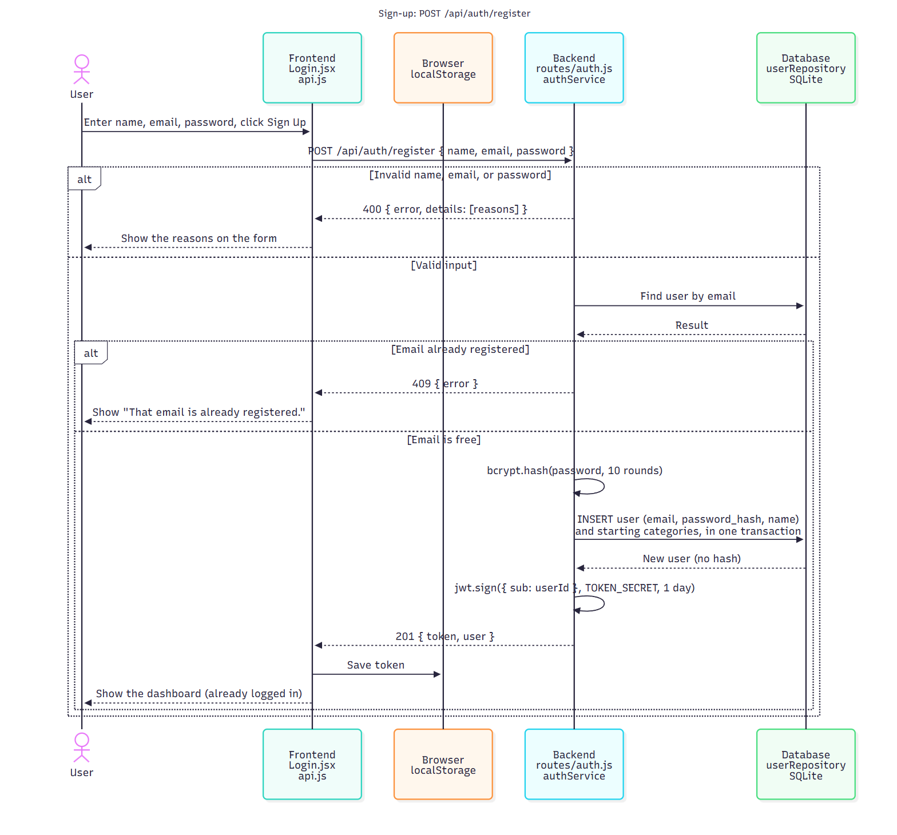
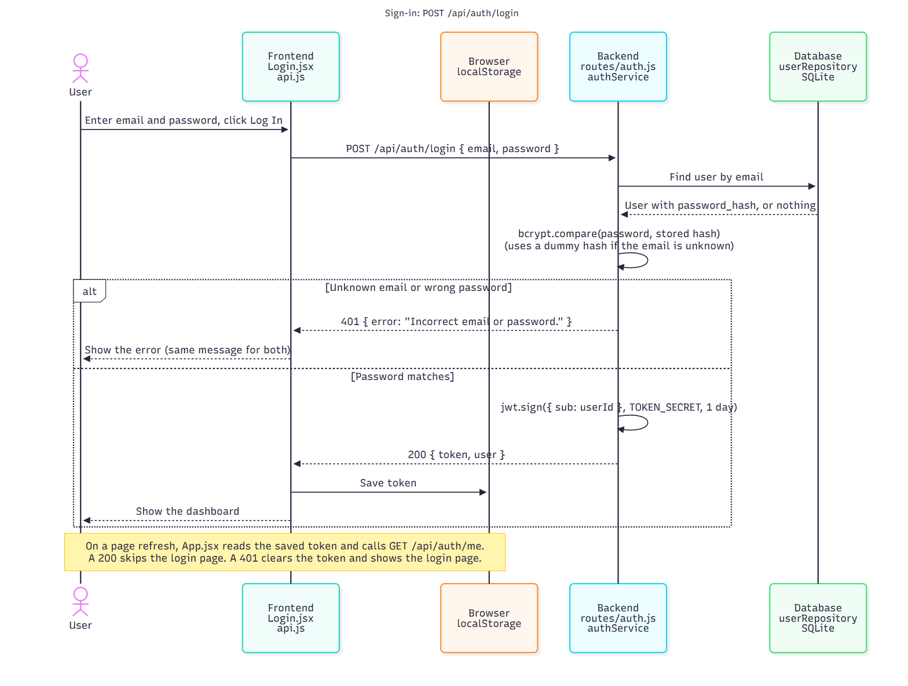
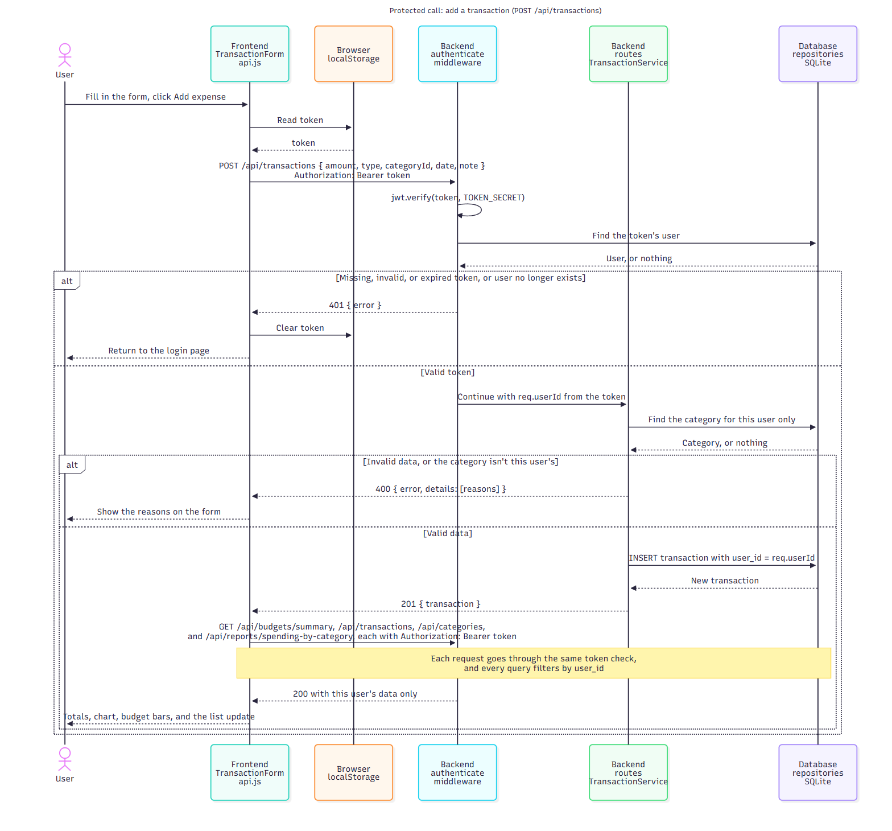

# LedgerLogic (finance-budget-tracker)

[](https://github.com/shreev2703/finance-budget-tracker/actions/workflows/ci.yml)

A budget tracker for college students: log income and expenses, see your balance, and get warned before you blow a category budget.

Project SRD: https://docs.google.com/document/d/1Lc2qm145vXdAHm76jv-lCK-DichXJx5tS8it1oxZaaQ/edit?usp=sharing

## Course documents

| Assignment                                                | Document                                                                                                 |
| --------------------------------------------------------- | -------------------------------------------------------------------------------------------------------- |
| TE3: UML class diagram                                    | [docs/te3/TE3-UML-Class-Diagram.pdf](docs/te3/TE3-UML-Class-Diagram.pdf)                                 |
| TE4: Design and architectural patterns                    | [docs/te4/TE4-Design-and-Architectural-Patterns.pdf](docs/te4/TE4-Design-and-Architectural-Patterns.pdf) |
| TE5: Clean code and refactoring                           | Issues [#50](https://github.com/shreev2703/finance-budget-tracker/issues/50), [#53](https://github.com/shreev2703/finance-budget-tracker/issues/53), [#54](https://github.com/shreev2703/finance-budget-tracker/issues/54) |
| TE6: Access control                                       | [Sequence diagrams below](#access-control-te6)                                                           |
| Software Requirements Specification (PDF copy of the SRD) | [docs/srd/LedgerLogic-SRD.pdf](docs/srd/LedgerLogic-SRD.pdf)                                             |

Each assignment folder holds one PDF with all of its diagrams. The editable diagram sources (Mermaid + PNG + HTML) are in [docs/diagram-sources/](docs/diagram-sources/).

## Getting started

Requires Node.js 22.13 or newer.

```bash
npm install     # installs every workspace from the root
npm run dev     # starts the API (http://localhost:3001/api) and the website (http://localhost:5173) together
npm test        # backend tests
npm run lint
npm run seed    # reset the local database to demo data
```

Open http://localhost:5173 and log in with the demo account (`demo@ledgerlogic.app` / `demo-password`), or create your own. The website calls `/api/...`, and Vite forwards those requests to the API on port 3001. To run one side only: `npm run dev:api` or `npm run dev:web`.

The first start creates `packages/backend/data/ledger.db` and seeds a demo student with categories, budgets, and this month's transactions. The demo account gets fresh data when a new month starts. Stop the server before running `npm run seed`.

**Token secret:** for a stable login across API restarts, copy `packages/backend/.env.example` to `packages/backend/.env` and set `TOKEN_SECRET`. Without it, development uses a random secret per run, so a restart logs everyone out. Production refuses to start without it.

**Demo mode:** run the website alone with `VITE_DEMO=1 npm run dev:web` (or `set VITE_DEMO=1&& npm run dev:web` in Windows cmd) to use browser-only sample data with no backend. Any login works in this mode, so it is only for showing the UI.

In the frontend, call the API through `packages/frontend/src/api.js` (`api.login()`, `api.getSummary()`, `api.addTransaction()`, and so on). It adds the auth token to every call. Failed requests throw an `ApiError` with `status` and a `details` list of validation problems.

To present the app, follow [DEMO.md](DEMO.md).

## Layout

```
packages/
  backend/    Express REST API + SQLite
    src/
      db/            schema.sql, connection, seed data
      repositories/  all SQL queries
      services/      validation and business logic
      domain/        budget rules (remaining, 80% warning, over limit)
      routes/        HTTP endpoints
      middleware/    authentication, error handling
    test/            API tests (node --test)
  frontend/   React SPA (see docs/architecture/frontend.md)
```

## API

Every route except `/api/health`, `/api/auth/register`, and `/api/auth/login` requires an `Authorization: Bearer <token>` header and returns `401` without a valid one. Each route only sees or changes the logged-in user's data.

| Method | Path                                  | Description                                                                                                 |
| ------ | ------------------------------------- | ----------------------------------------------------------------------------------------------------------- |
| POST   | `/api/auth/register`                  | Create an account `{ name, email, password }`; returns `201 { token, user }` (400 invalid, 409 email taken) |
| POST   | `/api/auth/login`                     | Log in `{ email, password }`; returns `200 { token, user }` (401 if wrong)                                  |
| GET    | `/api/auth/me`                        | The logged-in user                                                                                          |
| GET    | `/api/transactions?categoryId=&from=&to=&limit=50` | Transactions, newest first; filters are optional (400 for a bad date or unknown category)                                                                                  |
| POST   | `/api/transactions`                   | Create `{ amount, type, categoryId, date, note }` (`type` is `INCOME` or `EXPENSE`, `date` is `YYYY-MM-DD`) |
| PUT    | `/api/transactions/:id`               | Edit a transaction; same body and rules as POST (404 if it isn't yours)                                     |
| DELETE | `/api/transactions/:id`               | Delete a transaction (404 if it isn't yours)                                                                |
| GET    | `/api/budgets/summary?period=YYYY-MM` | Monthly totals + per-category budget status (defaults to the current month)                                 |
| GET    | `/api/reports/spending-by-category?period=YYYY-MM` | The month's spending per category, largest first (defaults to the current month) |
| GET    | `/api/categories`                     | The user's income and expense categories, each with `budgetId` and `limitCents` for this month (or `null`)  |
| POST   | `/api/budgets`                        | Set a monthly limit `{ categoryId, limit, period? }` for an expense category (409 if one already exists)    |
| PUT    | `/api/budgets/:id`                    | Change a budget's limit `{ limit }`                                                                         |

## Access control (TE6)

Passwords are hashed with bcrypt and never returned. Sign-up and login return a JWT that lasts one day. The frontend keeps it in `localStorage` and sends it with every call. The backend's `authenticate` middleware checks it before any data route runs, and every query filters by the token's user. API responses are sent with `Cache-Control: no-store`, so financial data doesn't stay in the browser's cache.

### Overview



Drawn from the requests the running app actually makes. It replaces Juan S.'s [first draft](docs/architecture/sequence-overview-juan-s-draft.pdf), which showed a Microsoft sign-in the app doesn't have.

### Sign-up



### Sign-in



### Protected API call



Diagram sources are in [docs/architecture/](docs/architecture/) (`sequence-*.mmd`). Re-render after editing:

```bash
npx -y @mermaid-js/mermaid-cli -i docs/architecture/sequence-signup.mmd -o docs/architecture/sequence-signup.png -b white -s 2
```
