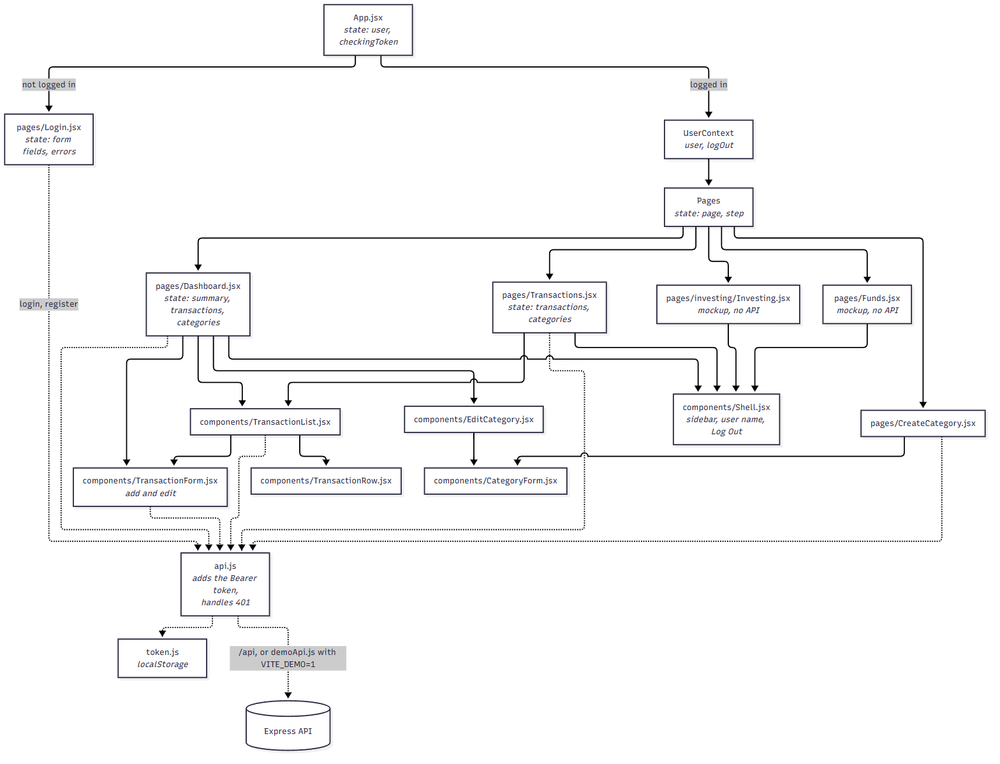

# Frontend architecture

Source: [`frontend-components.mmd`](frontend-components.mmd). Solid arrows show which component renders which. Dashed arrows show API calls.

## Where state lives

| State                                    | Lives in                            | Why                                                                                       |
| ---------------------------------------- | ----------------------------------- | ----------------------------------------------------------------------------------------- |
| Logged-in user                           | `App.jsx`, shared by `UserContext`  | `Shell` and `Dashboard` need it, and logging out has to reset the whole app               |
| Auth token                               | `token.js` (`localStorage`)         | Survives a page refresh. `api.js` is the only code that sends it                          |
| Current page and investing step          | `Pages` in `App.jsx`                | The app has no router; pages switch by state, and logging out resets them                 |
| Summary, transactions, and categories    | `Dashboard.jsx`, `Transactions.jsx` | Each page loads its own copy from the API, so the database stays the one source of truth  |
| Form fields and errors                   | Each form component                 | Nothing outside the form needs them until it is submitted                                 |

## How data flows after adding a transaction

1. `TransactionForm` validates nothing itself and calls `api.addTransaction()`. The backend is the one place the rules live.
2. `api.js` adds the `Authorization: Bearer` header and sends `POST /api/transactions`.
3. A `400` puts the reasons in the form's errors. A `401` clears the token and `App` shows the login page.
4. On success, `TransactionForm` calls `onSaved`, and `Dashboard` adds one to `reloadKey`.
5. That re-runs the `useEffect` that loads the summary, transactions, and categories, so the totals, budget bars, and list all update.

The [protected-call sequence diagram](sequence-protected-call.png) shows the same flow through the backend and database.
